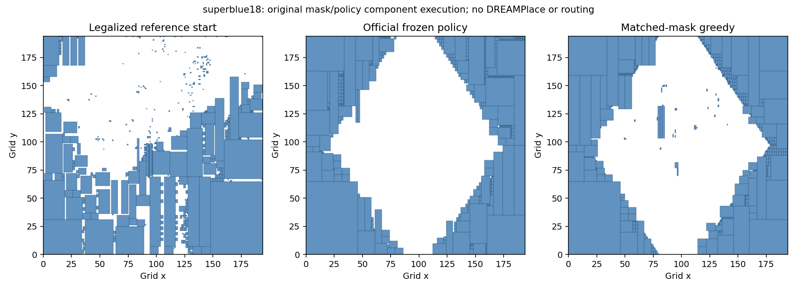

# MaskRegulate replication attempt on this PC

**Status, 17 October 2026:** the official checkpoint and original Python policy/environment components ran on a real ICCAD 2015 circuit. The original full entry point was attempted and failed because compiled DREAMPlace is unavailable. This is **component replication, not full paper reproduction**. No training, standard-cell placement, global HPWL, congestion, routing or PPA result is claimed.

## What actually ran

- Official repository: <https://github.com/lamda-bbo/macro-regulator>.
- Pinned commit: `fe475473c86121bd09e031b6329f18e2d8b9d5ce`; vendor tracked files remain unchanged.
- Authentic official benchmark download: [iccad2015.ot.zip](https://drive.google.com/file/d/1JEC17FmL2cM8BEAewENvRyG6aWxH53mX/view?usp=sharing), 530,920,224 bytes. All designs total 2,309,686,707 bytes uncompressed; only superblue18 was extracted locally.
- Official checkpoint: 49,073,954 bytes; SHA-256 `417db848622828487d81521bf6ef0b60b096f46511714e6ab0ca069620c9c9cc`.
- Isolated environment: CPython **3.8.20**, PyTorch **1.7.1+cpu**, torchvision **0.8.2+cpu**, NumPy **1.21.2**. Most requested dependency pins match upstream; Python patch version and CPU wheel variant differ. The complete installed package list is in `artifacts/environment_freeze.txt`.
- Device: Intel Core Ultra 7 155H, 16 cores/22 logical processors, about 32 GiB system RAM, Intel Arc integrated graphics. No NVIDIA CUDA device was detected. WMI's reported adapter RAM is not a reliable measurement of integrated GPU memory. The user has GPU access on a different machine; no remote host was supplied.

The checkpoint loaded strictly using the original `PPOAgent`. A diagnostic forward pass produced 50,176 finite probabilities summing to one, with zero mass on masked sites and a repeatable valid argmax. See `artifacts/checkpoint_smoke.json`.

The real-circuit experiment then used the **original parser, module ordering, mask generation, state normalization, reset/step logic and frozen PPOAgent** on superblue18: 768,068 DEF instances, upstream largest-512 selection, and 322 retained selected-module nets. It executed a complete 512-action pass, plus a same-start greedy mask control.

## Exact scope of the real-circuit adapter

The final successful run preserves the upstream **active 194 × 194 compressed canvas**, within the policy's original 224 × 224 image/action grid. No silent 194-to-224 relaxation is used in the reported result.

The necessary deviations are explicit:

1. A fail-fast backend import shim permits loading `ProblemInstance` without compiled DREAMPlace. Attempting to construct that shim's backend raises an exception; it supplies no fake placement result.
2. `PlaceEnv.__init__`'s DREAMPlace initialization and file-copy work are bypassed. Original `reset`, `step`, masks and neural modules execute without source edits.
3. A nearest-reference-site grid legalizer supplies the starting placement instead of DREAMPlace. The raw grid projection has 55 out-of-bounds modules and 173 overlapping pairs on the compressed canvas. The repaired start has none.
4. Environment `test_mode=False` suppresses backend evaluation at episode end. The neural agent stays in `eval()` mode and receives no gradient updates.
5. Reward min/max scaling is disabled because no training calibration is performed. This changes logged reward, not the original action mask normalization or the loaded policy parameters.
6. The independent geometry checker tests rectangle bounds and overlaps only, not site, halo, orientation or routing rules of a complete physical-design flow.

An earlier diagnostic used the full 224-grid canvas and completed both passes, but encountered a NumPy JSON serialization error. Its console/action traces are retained for transparency. It is not the reported native-canvas experiment. The serialization issue was fixed, intermediate artifacts were made durable, and the native 194-canvas experiment completed successfully.

## Measured native-canvas results

These numbers describe one CPU component experiment with a repaired DEF-derived start. They are not directly comparable with paper tables or evidence of multi-circuit generalization.

| Placement | Independent selected-net pin HPWL | Change from legal start | Rectangle violations | Pass wall time |
|---|---:|---:|---:|---:|
| Repaired legal start | 174,465.330625 | — | 0 | 0.35 s initialization repair |
| Official frozen checkpoint, 512 actions | 206,362.421339 | **18.28% worse** | 0 | 59.01 s |
| Matched-mask greedy, 512 actions | 100,005.499375 | **42.68% better** | 0 | 30.25 s |

Both completed passes had zero masked-action legality penalties. The parser took 18.85 seconds. Pass timings exclude the shared parser, model construction/loading, initial reset, final independent checks and plotting; they include action selection and environment stepping. These are single-run observations, not uncertainty estimates or full-pipeline latency claims. The policy and greedy control optimize a blend including regularity, so HPWL alone is not their complete training objective.

The final one-command cached integration check also completed successfully and reproduced identical positions, action traces and metric-audit outputs. Timings changed to 96.85 s and 31.31 s on the busy PC; this reinforces that the latency figures are observations rather than controlled benchmarks. See `artifacts/integration_verification.json`. No further experiment is needed for the current mid-semester preliminary-work scope.

The official checkpoint's worse independent HPWL must be reported honestly. The changed starting-layout distribution is a reason to investigate, not an established cause. A single modified-initialization case cannot refute the paper's results. The independent calculation verifies extrema over the upstream selected-net and pin-offset representation; it is not an orientation-aware evaluation of every standard-cell net in the physical design.



### Why the upstream macro-HPWL number differs

The original `utils.comp_res` reports 154,486.752054 for the legal start, 144,183.317143 after the policy and 65,667.401696 after greedy. The independent direct pin-extrema calculation disagrees. The metric audit keeps both definitions and identifies source behavior rather than silently patching it: `comp_res` initializes both minima using `max_height` and counts a net only if its minimum x-coordinate is at most `max_height`.

The per-net audit confirms the cause: the physical scaled width is 4,613.58 while height is 3,050.64. The helper drops 42 of 322 nets in the legal start, 123 after the policy and 80 after greedy. Their omitted HPWL sums explain the full discrepancy in every phase; re-executing the native formula agrees with `comp_res`. No negative pin coordinates occurred. See `artifacts/native194/macro_hpwl_audit.json` and the per-net CSV. **This concerns the auxiliary macro-HPWL helper. The paper's global HPWL uses DREAMPlace metrics; this observation does not establish an error in published global-HPWL or PPA results.**

It also does not establish that the policy exploited this helper: the wire-mask reward and DREAMPlace-based checkpoint scoring use other code paths. The independent audit changes reporting only and leaves the original action/reward computations untouched.

## Local files and one-command rerun

Source, checkpoint, environment and benchmark data live outside the tracked repository at:

```text
C:\Users\adity\.cache\chip-refinement-reproduction\
  .venv\
  macro-regulator\
  downloads\iccad2015.ot.zip
```

From the project root, run:

```powershell
pwsh -NoProfile -File .\reproduction\run_local.ps1 -Setup
```

This installs an isolated Python environment, obtains the pinned source and archive when absent, validates hashes, extracts superblue18, and reruns checkpoint, real-circuit component and metric-audit scripts. It requires Git, uv/uvx and network access. Downloads are approximately 0.8–1 GiB on an empty cache, including the benchmark, CPU packages and the ImageNet initializer required by the original constructor. It does not install system GPU drivers, Docker or WSL.

With the environment/data already present:

```powershell
pwsh -NoProfile -File .\reproduction\run_local.ps1
```

The scripts are research adapters, not a replacement implementation of MaskRegulate. Source URLs, hashes, package versions, commands, failures, successful JSON results, all selected positions and action traces are preserved under `artifacts/` and `commands.md`.

## Full original pipeline: measured local blockers

The exact native entry-point attempt is in `artifacts/original_entrypoint.txt`: it exits with `ModuleNotFoundError: No module named 'DREAMPlace'`.

A real CMake CPU configuration was also attempted against the bundled backend with GCC 15.2, CMake 3.27.9 and Ninja. It detected Python 3.8.20, Torch 1.7, OpenMP and ZLIB, then failed to find Boost headers (required ≥1.55). See `artifacts/dreamplace_configure.txt`. Installing one missing dependency would not prove the remaining Windows/native-toolchain port is compatible. The original repository supplies a Linux Docker workflow; this PC does not currently have Docker available, and WSL status queries did not return promptly. No WSL/driver installation or reboot was attempted.

## Running the original pipeline on the separate NVIDIA/Linux machine

The following commands are prepared instructions, **not executed remote results**. They follow the upstream workflow and keep its algorithm intact. The Docker tag is mutable: record the pulled image's digest before drawing reproducibility conclusions.

```bash
git clone https://github.com/lamda-bbo/macro-regulator.git
cd macro-regulator
git checkout fe475473c86121bd09e031b6329f18e2d8b9d5ce
nvidia-smi
docker pull duketomlist/macro-regulator:cuda
docker image inspect duketomlist/macro-regulator:cuda \
  --format '{{json .RepoDigests}}' > docker-image-digest.json
docker run --rm --gpus all --shm-size=8g \
  -v "$PWD":/workspace -w /workspace \
  duketomlist/macro-regulator:cuda bash
```

Inside the container:

```bash
cmake -S DREAMPlace_source -B DREAMPlace_source/build \
  -DCMAKE_INSTALL_PREFIX=/workspace/DREAMPlace
cmake --build DREAMPlace_source/build -j4
cmake --install DREAMPlace_source/build
python -m pip install gdown==5.2.0
mkdir -p benchmark
gdown 'https://drive.google.com/uc?id=1JEC17FmL2cM8BEAewENvRyG6aWxH53mX' \
  -O /tmp/iccad2015.ot.zip
python -m zipfile -e /tmp/iccad2015.ot.zip benchmark
cd src
python main.py --name=official_checkpoint_superblue18 --gpu=0 \
  '--benchmark_train=[]' '--benchmark_eval=[superblue18]' \
  --check_point_path=../policy/pretrained_model.pkl \
  --eval_policy=True --n_dmp_eval=3 --seed=3
```

Important: current source recognizes **`--check_point_path`**, with an underscore after `check`. The README parameter table also mentions another spelling; use the source-supported form above.

For a training smoke test, before an expensive run:

```bash
python main.py --name=train_smoke --gpu=0 \
  '--benchmark_train=[superblue1]' '--benchmark_eval=[superblue1]' \
  --episode=1 --n_dmp_eval=1 --seed=3
```

An eventual paper-scale training command can explicitly request `--episode=1000` (the current YAML default is 1500), training on superblue1/3/4/5. For strict new research, keep test designs out of periodic checkpoint selection. Global HPWL requires a successful DREAMPlace run; routed timing/congestion in the original paper further requires its downstream flow/commercial tool access. Training alone does not reproduce those PPA results.
